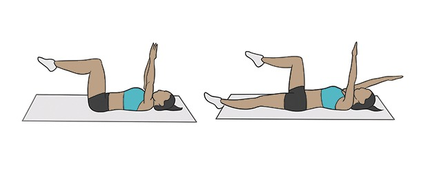
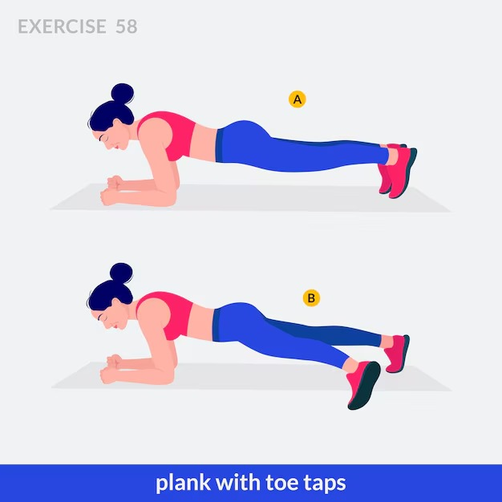
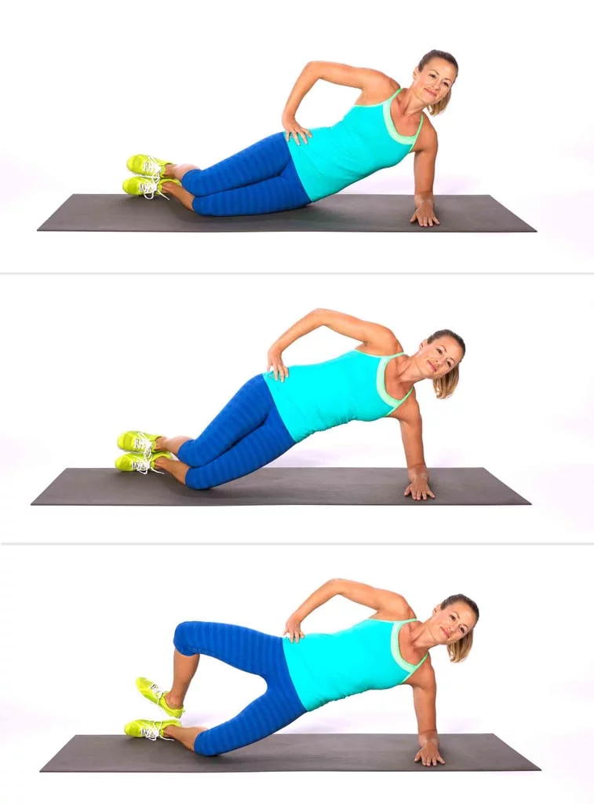
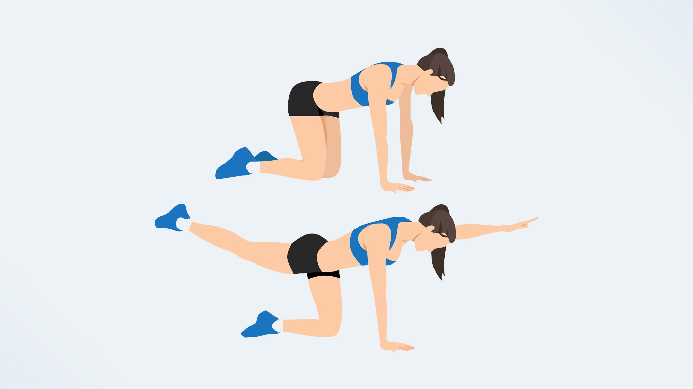
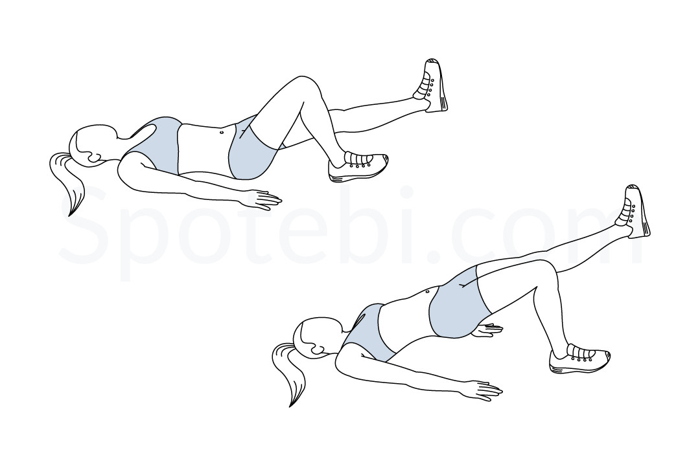
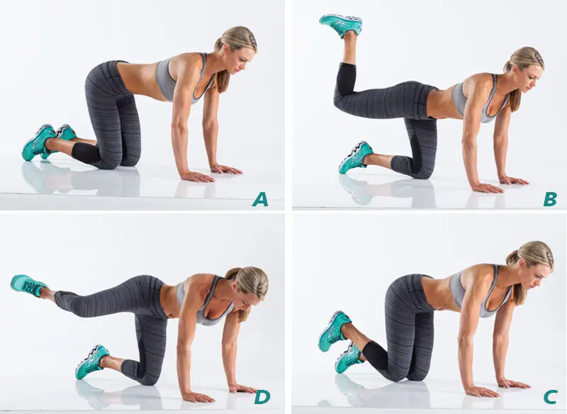

# 🏋️‍♂️ Tuesday: Deep Core & Glute Stability

*   **Total Time:** 15 Minutes
*   **Structure:** Complete the entire circuit **3 times** total. Rest 30 seconds between rounds.
*   **Focus:** Core stability over definition. Neck-safe movements.

---

&nbsp;

### 🛡️ Phase 1: Deep Core & Anterior Chain (5 Minutes)

#### 1. Deadbug
*   **Reps/Time:** 45 seconds of slow, alternating movement.
*   **Directions:** Lie on your back with knees bent at 90 degrees and arms reaching up. Flatten your lower back into the mat. Slowly lower your right arm overhead and left leg straight down. Return and switch sides.
*   **Why:** Teaches the deep transverse abdominis to stabilize your pelvis while your limbs move.

#### 2. Forearm Plank with Toe Taps
*   **Reps/Time:** 45 seconds continuous.
*   **Directions:** Hold a secure forearm plank. Keeping your pelvis level and locked, tap your right toe 6 inches out to the side. Return to center, then tap the left toe out.
*   **Why:** Challenges your entire rotational core stability against a moving anchor.

&nbsp;
---

### 🗺️ Phase 2: Lateral Core & Hip Stability (5 Minutes)

#### 3. Side Plank with Isometric Clamshell
*   **Reps/Time:** 30-second hold per side.
*   **Directions:** Lie on your side with knees bent at 90 degrees. Prop your torso up on your forearm and lift your hips into a side plank. Open your top knee toward the ceiling while keeping your feet stacked.
*   **Why:** Hits the obliques and the side glutes (gluteus medius) simultaneously for optimal hip tracking.

#### 4. Bird-Dog
*   **Reps/Time:** 45 seconds alternating sides (2-second hold at the top).
*   **Directions:** Start on your hands and knees. Extend your right arm straight forward and left leg straight backward. Hold for 2 full seconds while squeezing your core and glute. Switch sides.
*   **Why:** Interconnects the glutes to the opposite lower back muscles to create a stable posterior frame.

&nbsp;

---

### 🍑 Phase 3: Glute & Posterior Chain Stability (5 Minutes)

#### 5. Single-Leg Glute Bridge Iso-Hold
*   **Reps/Time:** 30-second hold per leg.
*   **Directions:** Lie on your back, knees bent, feet flat. Drive your hips up into a bridge. Fully extend your right leg straight out so it lines up with your left thigh. Keep both hips perfectly level.
*   **Why:** Eliminates pelvic tilting by isolating deep stabilizers under a single-leg load.

#### 6. Donky Kick to Fire Hydrant Combo
*   **Reps/Time:** 45 seconds on the Right, then 45 seconds on the Left.
*   **Directions:** On your hands and knees, drive your right heel up toward the ceiling (donkey kick). Lower without touching the mat, then lift your knee directly out to the right side (fire hydrant).
*   **Why:** Conditions the hip joint across multiple planes of motion in a single set.

