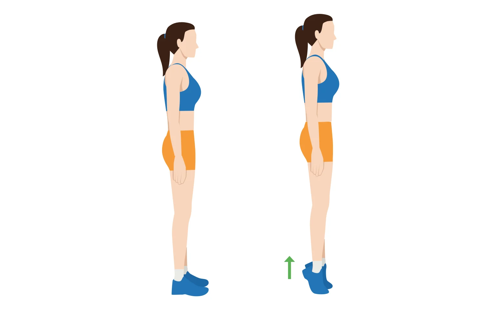
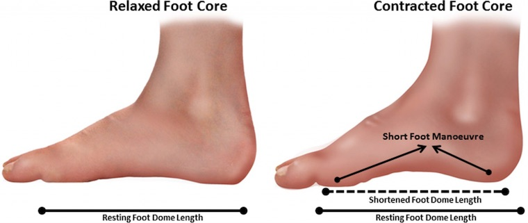
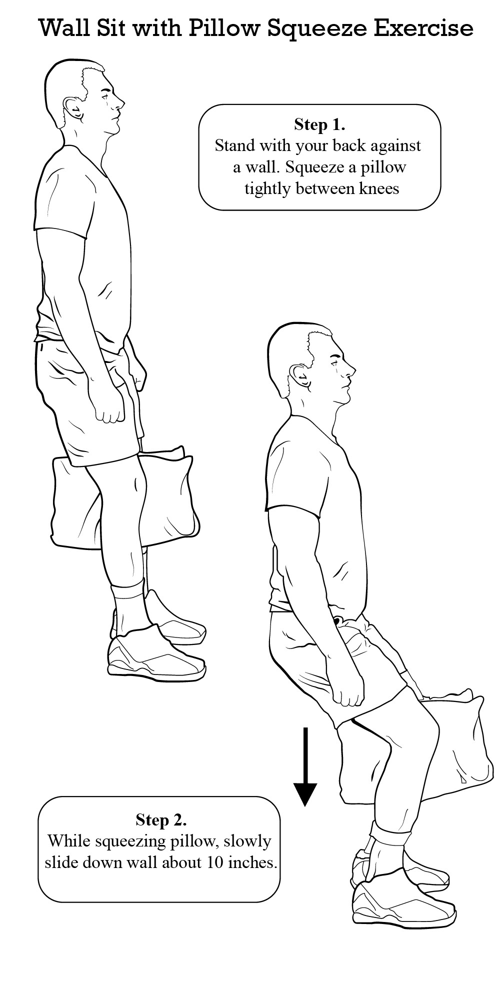
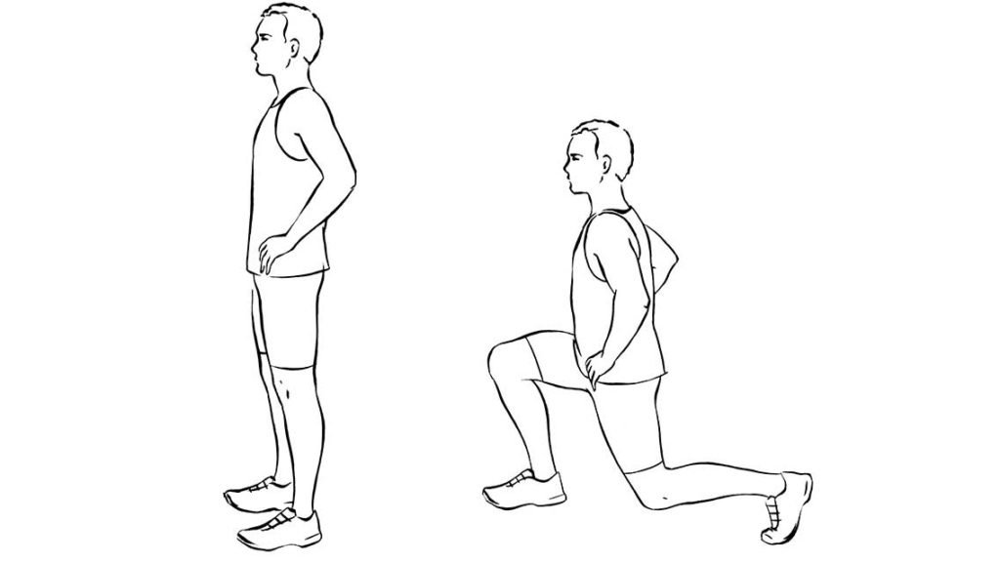
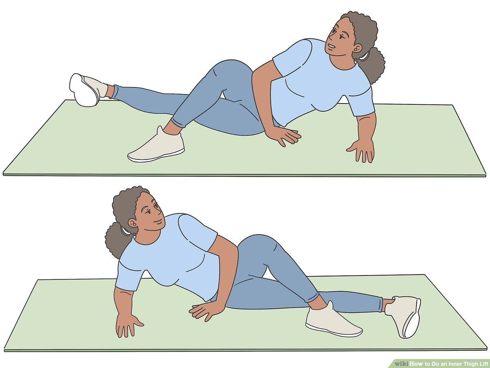
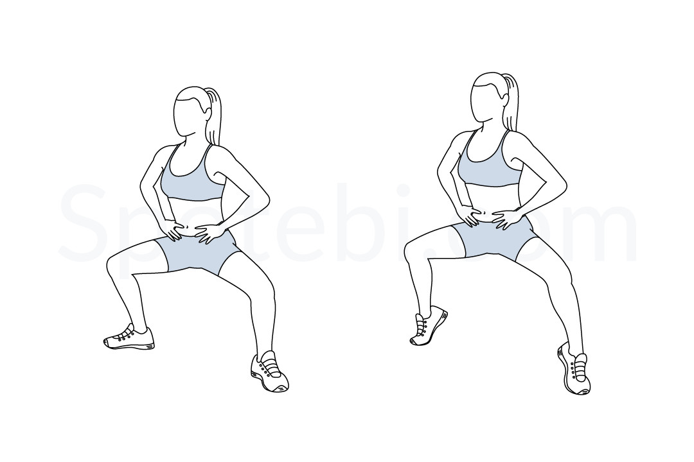

# 🏋️‍♂️ Monday: Ankle, Knee & Inner Thigh Stability

*   **Total Time:** 15 Minutes
*   **Structure:** Complete the entire circuit **3 times** total.
*   **Focus:** Prevention and lean muscle stability. Keep movement slow and controlled.

---

&nbsp;

### 🧱 Phase 1: Foot & Ankle Foundation (5 Minutes)

#### 1. Flat-Ground Straight-Knee Calf Raises
*   **Reps/Time:** 15 slow repetitions.
*   **Directions:** Stand flat on the floor. Raise up onto your toes over 2 seconds. Hold the peak contraction for 2 seconds. Lower your heels back down over 3 seconds. Keep knees completely straight.
*   **Why:** Strengthens tendons safely without overstretching the insertional Achilles attachment.
 

#### 2. Short Foot Isometric Holds
*   **Reps/Time:** Hold for 10 seconds. Repeat 5 times per foot.
*   **Directions:** Keep your foot flat on the floor. Actively pull the ball of your foot toward your heel without curling your toes. Your arch will lift naturally.
*   **Why:** Elevates and strengthens the deep plantar fascia arch structure.
 

&nbsp;

---

### ⚡ Phase 2: Knee Stability & Quad Toning (5 Minutes)

#### 3. Wall Sit with Pillow Squeeze
*   **Reps/Time:** 45-second hold.
*   **Directions:** Slide your back down a smooth wall until your thighs are parallel to the floor. Place a pillow or yoga block firmly between your knees. Squeeze the pillow continuously.
*   **Why:** Builds isometric knee stability while targeting the inner thigh adductors for a lean look.

#### 4. Backward Step-Downs
*   **Reps/Time:** 12 slow repetitions per leg.
*   **Directions:** Stand tall. Take a highly controlled step backward with your left foot, tapping your left knee lightly toward the floor. Drive through your front right heel to stand back up.
*   **Why:** Directs load to the VMO muscle right above the kneecap to permanently protect the joint.
 

&nbsp;

---

### 📐 Phase 3: Inner Thigh Sculpting (5 Minutes)

#### 5. Side-Lying Inner Thigh Lifts
*   **Reps/Time:** 20 quick pulses per side.
*   **Directions:** Lie down on your right side. Cross your left leg over the top, placing your left foot flat on the mat. Keep your bottom right leg completely straight and pulse it upward toward the ceiling.
*   **Why:** Perfectly isolates the upper inner thigh muscles without stressing joints.
 

#### 6. Plie Squat Isometrics (Feet Flat)
*   **Reps/Time:** 30-second low hold.
*   **Directions:** Stand with your feet wide, toes pointed outward at a 45-degree angle. Lower down into a wide squat position. Keep your feet flat on the floor to safe-guard your Achilles. Hold still.
*   **Why:** Burns out the upper thigh adductors while forcing core engagement.
 

